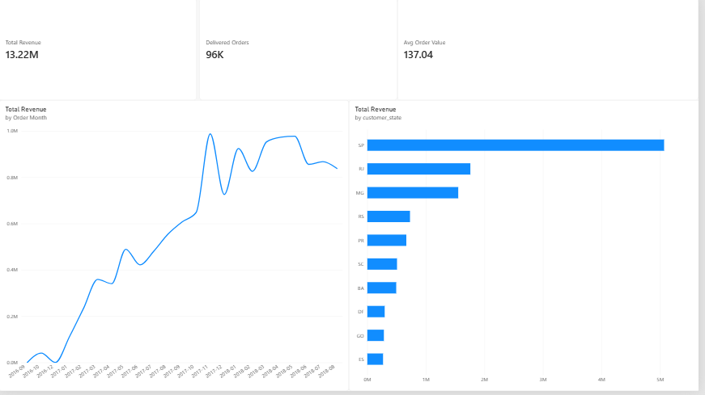

# E-Commerce Sales Analysis

SQL and Power BI analysis of the Olist Brazilian e-commerce dataset to understand revenue, order trends and regional performance.

## Dataset
[Brazilian E-Commerce Public Dataset by Olist](https://www.kaggle.com/datasets/olistbr/brazilian-ecommerce) (Kaggle). About 100,000 orders from 2016 to 2018. The raw CSV files are not included in this repo because of their size.

## Tools
- MySQL (MySQL Workbench)
- Power BI Desktop

## What I did
- Loaded 7 tables (orders, customers, order_items, order_payments, products, sellers, category_translation) into MySQL.
- Joined orders with order items and customers to calculate revenue, order counts and average order value.
- Used only delivered orders. Revenue is based on item price and does not include freight.
- Connected Power BI to the MySQL database, set up table relationships and built measures for revenue, delivered orders and average order value.
- Built a report with three KPI cards, a monthly revenue trend and a top 10 states chart. The numbers match the SQL results.

## SQL queries
| File | What it does |
|---|---|
| `01_total_orders_revenue.sql` | Total delivered orders and revenue |
| `02_avg_order_value.sql` | Average order value |
| `03_monthly_revenue.sql` | Orders and revenue by month |
| `04_revenue_by_state.sql` | Top 10 states by revenue |

## Results
- Delivered orders: 96,478
- Total revenue: R$ 13,221,498.11
- Average order value: R$ 137.04

## Key insights
- São Paulo (SP) is the biggest market. It brings in about R$ 5.07M, roughly 38% of total revenue.
- SP, RJ and MG together account for about 63% of revenue.
- Revenue grew steadily through 2017 and peaked in November 2017 (about R$ 0.99M, 7,289 orders). This may be linked to Black Friday, but the data alone does not confirm it.
- In 2018, monthly revenue stayed roughly between R$ 0.83M and R$ 0.98M, so growth levelled off.
- The average order value is R$ 137.04.

## Notes
- Data from 2016 has very few orders, so it is not used to read trends.
- Revenue does not include freight charges.

## Project status
SQL analysis and the Power BI report are complete.
